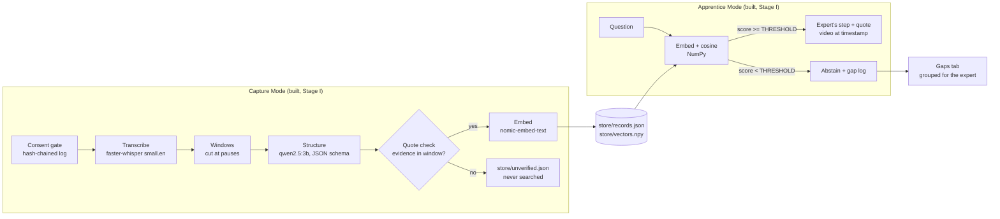

# The Master's Shadow — Stage I prototype

**Team FORNAX · ASUS UGen AI League Innovation Hackathon 2026 · Workplace AI · Battlefield Lightning**

With an expert's consent, the system transcribes their narrated task, turns it into structured
records (step, component, reason, failure sign, exact quote, timestamp), indexes them locally, and
lets a junior ask in plain language. The answer is the expert's own matching step, with the video
opened at that moment. If nothing matches well enough, it **abstains** and logs the question as a
knowledge gap for the expert.

**Scope, stated plainly.** Stage I runs sequentially on one laptop as a feasibility simulation.
Live camera capture, real-time processing, a hardware consent switch and anything on the
UGen300 / Hailo-10H are Stage II. **No code in this repository runs on Hailo hardware.**
After the one-time model downloads, nothing makes a network call at runtime.

## Architecture



| Component | Stage I (this repo) | Stage II (planned, not built) |
|---|---|---|
| Consent | Software gate; hash-chained log; refusals logged | Badge or physical switch tied to recording |
| Capture | Pre-recorded mp4 with narration | Live camera and microphone |
| Transcribe | faster-whisper small.en on laptop CPU/GPU | Compile test for Hailo-10H; host fallback |
| Structure | qwen2.5:3b via Ollama, schema JSON, quote check | Small LLM on UGen300 if it compiles, else host |
| Search | nomic-embed-text + NumPy cosine, abstention | Same, plus visual anchors |
| Gaps | Logged and grouped | Prompted at the next capture session |
| Hardware | Laptop only | Measured host vs host + UGen300 split |

## Files

| File | Purpose |
|---|---|
| `config.py` | Every setting: models, device, window lengths, thresholds |
| `consent.py` | Consent gate and hash-chained ledger (`verify()`) |
| `transcribe.py` | Clip → timed segments (timestamps come only from here) |
| `windows.py` | Segments → windows cut at pauses, with read-only context |
| `structure.py` | Window → records via Ollama; quote check marks `verified` |
| `index.py` | Append/replace records by source; `delete_record`; sample loader |
| `query.py` | Search, abstention, gap logging |
| `gaps.py` | Groups gap questions |
| `run_pipeline.py` | One command for the whole capture loop |
| `app.py` | Streamlit demo: Ask, Capture, Gaps, Expert review, Ledger |
| `eval.py` | Results-table numbers; never writes the index or gap log |
| `label_eval.py` | You write eval questions per record; adds 10 unanswerable ones |
| `tune.py` | Suggests (and with `--write` saves) THRESHOLD and GAP_SIM from your data |
| `report.py` | Measures on this machine and fills the automatic results rows |
| `tests/test_ledger.py` | Tamper tests |

## Setup (Windows 11, PowerShell, while online)

```powershell
mkdir masters-shadow; cd masters-shadow        # or: git clone <repo-url>; cd <repo>
py -3.11 -m venv .venv
Set-ExecutionPolicy -Scope Process -ExecutionPolicy Bypass
.\.venv\Scripts\Activate.ps1
python -m pip install --upgrade pip
pip install -r requirements.txt

# Ollama (install from ollama.com first; it runs on localhost:11434)
ollama pull qwen2.5:3b
ollama pull nomic-embed-text
ollama list

# One-time speech model download (CPU check)
python -c "from faster_whisper import WhisperModel; WhisperModel('small.en', device='cpu', compute_type='int8'); print('whisper ok')"
```

**Optional GPU for speech (NVIDIA).** CPU is the default and is enough for Stage I. To try CUDA:

```powershell
pip install nvidia-cublas-cu12 "nvidia-cudnn-cu12==9.*"
$env:MS_DEVICE = "cuda"
python transcribe.py data\clips\test.mp4
```

If that errors, close the shell (or `Remove-Item Env:MS_DEVICE`) and stay on CPU. Ollama uses the
GPU on its own; check with `ollama ps` while a model is loaded.

## Run

```powershell
python -m pytest                                              # ledger tamper tests
python run_pipeline.py data\clips\demo.mp4 --who "Expert"     # must REFUSE (no --consent)
python run_pipeline.py data\clips\demo.mp4 --who "Expert" --consent
python query.py "why is the pressure needle oscillating?"
streamlit run app.py
```

Clips must live in `data/clips/` for the app to play them. Offline check: after the downloads,
`$env:HF_HUB_OFFLINE = "1"`, turn Wi-Fi off, and run the pipeline and app again.

**Fallback demo only:** `python index.py --load-samples` adds six hand-written records, labelled
SAMPLE everywhere in the app. Remove them with `python index.py --remove-samples` before
measuring or filming the real demo.

## Demo flow

1. Wi-Fi off; Ledger tab shows the chain verified.
2. Capture tab: Start with consent unticked → refused, and the refusal is in the ledger.
3. Tick consent, enter the expert's name, capture the clip.
4. Ask a question the clip answers → the expert's step, quote, and video at that moment.
5. Ask something the clip does not cover → abstention.
6. Gaps tab: the abstained question is there.
7. Expert review: delete a record, ask again, it is gone. Ledger tab: still verified, deletion logged.

## Evaluate, tune and report (before measuring or filming)

```powershell
python index.py --remove-samples                       # samples must not be in the measured index
python run_pipeline.py data\clips\hyd5.mp4 --who "Tester" --consent
python label_eval.py hyd5.mp4                          # you write 10 questions, one per record
python tune.py                                         # read the scores and suggestions
python tune.py --write                                 # save THRESHOLD and GAP_SIM to config.py
python eval.py                                         # check: abstentions now behave
python report.py data\clips\hyd5.mp4 --source "<where the clip came from>"
```

`label_eval.py` never writes questions itself: ground truth comes from a person. Write them as a
junior with the problem would ask, not in the record's words. `tune.py` puts THRESHOLD between
the scores of correctly answered and unanswerable questions, and GAP_SIM between paraphrase pairs
(`data/gap_pairs.json`) and different questions. Because both are tuned on the same questions the
results report, the results are indicative, not a held-out test, and `report.py` records that.

## Results

Feasibility check on one machine, not a benchmark.

| Metric | Value | How measured |
|---|---|---|
| Test clip | `hyd10.mp4`: Abom79, Hydraulic System Inspection & Troubleshooting Session 2 (archive.org), first 10 min, third-party test clip | Not in this repository |
| Machine | Intel(R) Core(TM) Ultra 9 275HX; 31 GB RAM; NVIDIA GeForce RTX 5070 Ti Laptop GPU, 12227 MiB; Windows 11 (build 10.0.26300); Python 3.11.9; Ollama 0.40.11 | report.py (OS, nvidia-smi, ollama) |
| Speech device | cpu / int8 | `config.py` |
| Clip length | 600 s | PyAV |
| Expected steps (hand-labelled) / extracted correctly | Not measured for Stage I (time); see the 10-record read-through | Read against transcript |
| Of 10 records: correct, incomplete, invented | 2, 8, 0 (first 10 records in index order, judged by a team member) | Read against transcript |
| Records rejected by the quote/grounding checks | 5 of 24 (indexed run); 5–11 of 24–26 over 5 timing runs (saved run: 11 of 26) | `store/unverified.json`, `eval.py <clip>` |
| Answerable (of 10): top-1, top-3, wrongly abstained | 4, 7, 2 | `eval.py` |
| Unanswerable (of 10): correctly abstained | 10 | `eval.py` |
| Seconds: transcribe, window, structure, embed (total) | 82.7–96.3, 0.00, 12.3–12.9, 0.1 (95.1–109.3) over 5 timing runs (saved run: 83.1, 0.00, 12.5, 0.1 (95.6)) | `eval.py <clip>` |
| Median query time | 0.025 s over 20 queries | `eval.py` |
| Peak memory: Ollama, Python, VRAM | Ollama 1.7 GB RAM (1774 MB), Python 0.7 GB RAM (685 MB), GPU 2757 MiB of 12227 MiB VRAM (whole-GPU total, includes the desktop); peak during one timing run; speech runs on CPU, so VRAM is the LLM and embedder | `Get-Process` working set sampled every 1 s, `nvidia-smi -l 1` (timing run 4) |
| THRESHOLD tuned on the same questions? | yes; THRESHOLD = 0.643, GAP_SIM = 0.645 | `tune.py` |

Verdict rule: invented = any field states something the speaker does not say, or names an action
they contradict or a different part; the imperative verb in 'step' is the requested format, not
counted as invented. Incomplete = nothing false, but a stated reason or failure sign is missing or
the field is a fragment. Finding: no invented records in the sample; most records are thin, with
the speaker's reason preserved only in the verbatim quote shown on every answer card.

Two evaluation runs on the same 10 + 10 questions: (1) embedding step text only;
(2) embedding step text plus the verified quote, a change made after seeing run 1's misses.
Both are reported; run 2 is not a held-out result. Near-duplicate records across adjacent
windows (e.g. two brass-shoe records) count as misses at top-1 under strict labels.
Abstention margin: highest unanswerable 0.606 vs lowest correct 0.582: the groups overlap by
0.024, so no single threshold separates them; THRESHOLD = 0.643 makes 1 error(s) on these 20
questions and is fragile (tune.py counts only correctly ranked questions; eval.py shows 2
answerable questions abstaining).

`tune.py`'s `best_cut` was changed to a mid-gap rule (cuts only between observed scores, never on
one) after run 2, before tuning. Raw outputs: `results/eval_1_step_only.txt`,
`results/eval_2_step_plus_quote.txt`, `results/eval_3_tuned.txt` (run 2's index with the tuned
THRESHOLD).

The evaluated index (19 records) was extracted before two stricter checks were added to
`structure.py` (the exact quote match now requires whole words; a record whose component has no
content word is now rejected); the timing runs use the current code. Re-checking the 19 indexed
records with the current checks rejects none of them.

## Known limitations

- One clip and twenty questions; numbers are indicative only.
- Record extraction is not deterministic at temperature 0 on GPU (Ollama qwen2.5:3b):
  5 timing runs on the same transcript gave 15–19 verified records of 24–26 extracted. Setting a
  fixed sampling seed is a Stage II fix. Retrieval results above are measured on one fixed index.
- The quote check accepts an exact match, or a near-copy (word similarity >= 0.80, `SNAP_MIN` in
  `structure.py`) which is then replaced by the verbatim transcript words; each record stores how it
  matched in `match`. Raise `SNAP_MIN` to be stricter.
- A grounding check rejects a record whose component never appears in the transcript, and blanks a
  rationale or failure sign when under half its content words appear there. Word overlap is a coarse
  test: a reason built from the speaker's own words in a wrong combination can still pass.
- A 3B model can still invent a rationale. The quote check only proves the **evidence** quote is in
  the transcript, not that every field is faithful. Expert review is the backstop.
- The extractor skips some explained content (e.g. reservoir functions in w02); coverage was not
  measured.
- Record timestamps are the window's start and end, not the exact sentence.
- small.en is English only and may mishear jargon or speech over machine noise.
- The ledger shows tampering, not identity: names are typed in, and someone with file access could
  rewrite the whole chain. Anchoring the latest hash externally is Stage II.
- If the app and the CLI write the ledger at the same moment, lines can interleave; run one at a time.
- Nothing has run on the UGen300. No Hailo performance claim is made.

## Licenses

| Component | License | Status |
|---|---|---|
| qwen2.5:3b (Qwen2.5-3B-Instruct) | Qwen Research License — **non-commercial** | Checked on the model page, 27 Oct 2026 |
| faster-whisper (code) | MIT | Checked (SYSTRAN/faster-whisper) |
| faster-whisper small.en weights | MIT conversion; upstream OpenAI Whisper weights | Upstream **unchecked** |
| nomic-embed-text v1.5 | Apache 2.0 | Checked on the model page |
| Ollama | unchecked | **unchecked** |
| Streamlit | unchecked | **unchecked** |
| NumPy, PyAV, CTranslate2 | unchecked | **unchecked** |

A commercial product would need qwen2.5:3b swapped for a model whose license allows commercial use.
